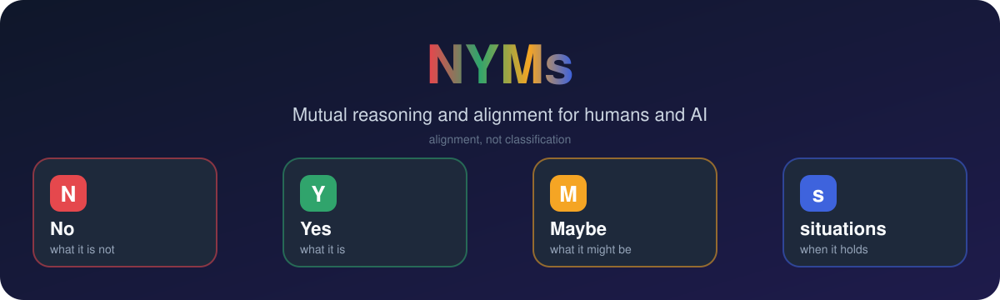

<div align="center">



**English** · [简体中文](README.zh-CN.md)


</div>

## ✨ What is NYMs?

**NYMs** (**N**o, **Y**es, **M**aybe, **s**ituations) is a bidirectional reasoning and alignment skill for humans and AI, packaged as an Agent Skill for Claude Code and Claude.

> 🎯 The goal is **alignment, not classification**: see what is excluded, what is accepted, what is still open, and when each holds, then get back to the work.

## 🧩 The idea

| | Describing a concept | Guiding an action |
| --- | --- | --- |
|  **No** | What it is **not** | What must **not** happen |
|  **Yes** | What it **is** | What is desired, required, or permitted |
|  **Maybe** | What it **might** be | What is undecided or worth exploring |
|  **situations (when)** | When a claim holds | What changes applicability and risk |

### 🔍 Four distinctions it keeps explicit

- ❌ **Not true** ≠ 🤔 **not yet established**
- ✅ **Required** ≠ 👌 **permitted**
- 💭 **Possible** ≠ 🔑 **authorized**
- 🗣️ **Stated** ≠ 🧠 **inferred**

### 🔄 Both directions

The AI states its own NYMs too, instead of only organizing the human's. Either side can propose, question, or revise.

## ⚡ When it triggers

- 💬 You mention NYMs.
- 🗣️ Any discussion between the human and the AI: design, planning, debugging, trade-offs, opinions, open questions.
- 🌫️ Things are confused, or a gap shows up or is being closed.

🛑 Once aligned, it stops and acts. It never turns a clear request into a questionnaire.

## 🚀 Install

**Claude Code**

```bash
git clone https://github.com/jinhuang712/nyms ~/.claude/skills/nyms
```

**Claude (claude.ai)**

Zip the folder so that `nyms/SKILL.md` is inside, then upload it under Settings → Capabilities → Skills.

## 📁 Files

- 📄 [`SKILL.md`](SKILL.md): the skill itself (semantics, protocol, self-governance, output format)
- 🎨 [`assets/`](assets): hero and icons used by this README

## 📜 License

[MIT](LICENSE)
