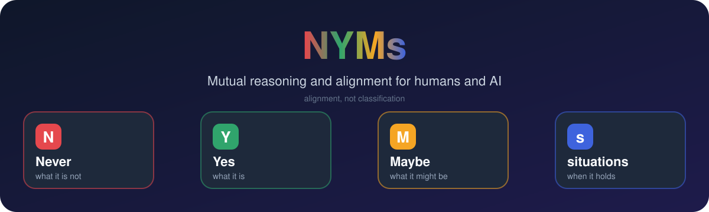

<div align="center">



[English](README.md) · **简体中文**


</div>

## ✨ NYMs 是什么?

**NYMs**(**N**ever、**Y**es、**M**aybe、**s**ituations)是一个人与 AI 双向的推理与对齐 skill,以 Agent Skill 的形式提供给 Claude Code 和 Claude。

> 🎯 目标是**对齐,不是分类**:看清什么被排除、什么被接受、什么还悬而未决、各自在什么情况下成立,然后回去做事。

## 🧩 核心想法

| | 描述一个概念 | 指导一个行动 |
| --- | --- | --- |
|  **Never(绝不)** | 它**不是**什么 | 什么**不能**发生 |
|  **Yes(是)** | 它**是**什么 | 想要的、必须的、允许的 |
|  **Maybe(或许)** | 它**可能**是什么 | 尚未决定、值得探索的 |
|  **situations(情境)** | 判断在什么情况下成立 | 什么会改变适用性和风险 |

### 🔍 它始终分清的四组区别

- ❌ **不是真的** ≠ 🤔 **还没被证实**
- ✅ **必须** ≠ 👌 **允许**
- 💭 **可能** ≠ 🔑 **已授权**
- 🗣️ **你说过** ≠ 🧠 **我推断的**

### 🔄 双向

AI 也要说出自己的 NYMs,而不只是整理人的。任何一方都可以提出、质疑或修订。

## ⚡ 何时触发

- 💬 你提到 NYMs。
- 🌫️ 人和 AI 还没形成共识:事情混乱、需要讨论,或者双方出现 gap、正在弥合。

🛑 对齐之后就停下来去做事。它不会把清楚的请求变成问卷。

## 🚀 安装

**Claude Code**

```bash
git clone https://github.com/jinhuang712/nyms ~/.claude/skills/nyms
```

**Claude(claude.ai)**

把文件夹压成 zip,保证里面是 `nyms/SKILL.md`,然后在 Settings → Capabilities → Skills 上传。

## 📁 文件

- 📄 [`SKILL.md`](SKILL.md):skill 本体(语义、协议、自我约束、输出格式)
- 🎨 [`assets/`](assets):本 README 用到的头图和图标

## 📜 许可证

[MIT](LICENSE)
